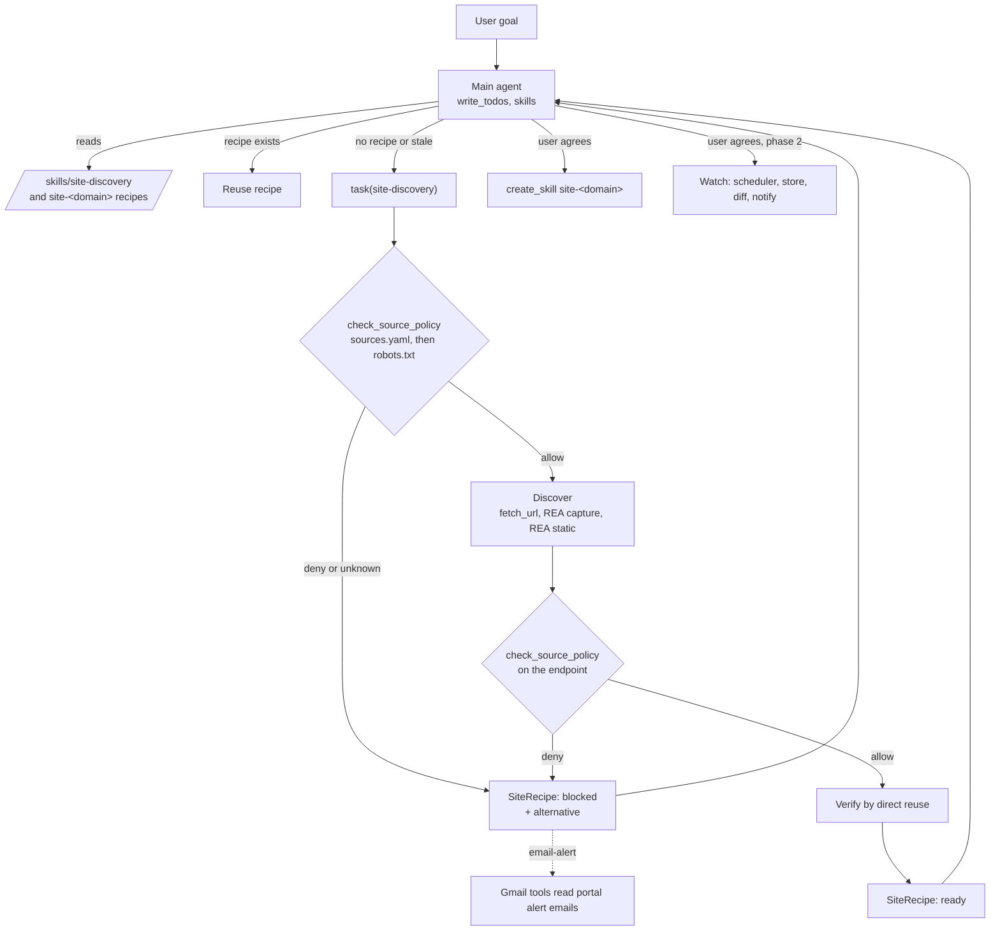

# Research: an agent that discovers and uses unknown websites

Status: approach final; phase 1 built on branch `feature/site-discovery-rea`.
Date: 2026-10-17.
Style: ASD-STE100 (short sentences, active voice, one meaning per word).

## 1. Decision

EAF does not get one workflow per website. EAF gets a general method and general tools. The agent learns each website at run time, verifies what it learned, and saves it as a skill.

The final approach has six parts:

1. **Method.** A skill (`site-discovery`) tells the main agent when to discover a site and what to do with the result.
2. **Discovery subagent.** A subagent (`site-discovery`) finds the endpoint or page that holds the data. It uses REA over MCP. It returns a typed `SiteRecipe`.
3. **Policy gate.** A tool (`check_source_policy`) decides if automated access is permitted. A human file (`policies/sources.yaml`) wins over `robots.txt`. "Unknown" means "no".
4. **Verification by reuse.** A recipe is `ready` only after a direct call, without a browser, returns the expected shape.
5. **Learned skills.** The main agent saves each verified recipe as `skills/site-<domain>/SKILL.md`, with the user's agreement. The next request skips discovery.
6. **Time and state (phase 2).** A scheduler, a listings store and notifications run saved recipes again and report changes.

For Rightmove and Zoopla, the policy says `email-alert`. The agent tracks those portals through the user's saved-search alert emails, not through their internal APIs. Section 7 gives the evidence.

## 2. Problem

The user gives a goal, for example: "Track 2-bed flats in Hackney under £2,000 a month, and tell me about new ones."

The agent gets no workflow, no URL and no API description. It must:

1. Understand the goal and the filters.
2. Find the sources.
3. Decide if it may automate each source.
4. Learn how each source serves its data.
5. Get the data into one structure.
6. Do it again on a schedule.
7. Tell the user about changes.

More use cases will follow. A design with hard-coded sites needs new code for each one. That does not scale.

## 3. How frontier agents do this

Claude and ChatGPT have no special knowledge of each website. They combine six general mechanisms:

| Mechanism | What it gives |
|---|---|
| Prior knowledge | The model knows that a site exists and roughly how such sites work. This is a start point, not a fact. |
| Tool loop | The model asks for a tool, reads the result, and selects the next action. |
| General tools | Search, fetch, browser, HTTP. No tool is specific to one site. |
| Code | The model writes a small parser and corrects it from the errors. |
| Verification | The model compares the result with the goal before it stops. |
| Procedural memory | The model saves what worked as a skill and reads it next time. |

The intelligence is in the combination, not in a workflow.

## 4. Systems surveyed

### 4.1 Summary

| System | What it is | Main lesson for EAF |
|---|---|---|
| EAF (this repo) | deepagents harness on Bedrock | Strong base: planning, subagents, skills, MCP bridge, HITL. Missing: discovery, policy, scheduler, store, evals. |
| waku-agent | Small local agent, one loop | Observer events, cost ledger, deterministic evals with a scripted model, a release gate. |
| openmuse | Personal agent app (TypeScript) | Durable task worker with leases, self-rescheduling monitors, backoff, deduplicated notifications, hash-and-expiry approvals. |
| invisible_dots | Self-hosted "Dots" agent, one VM per agent | Same core idea: general tools, the agent writes its own `SKILL.md`, gated automations, an intent journal so an interrupted call is never run twice. |
| REA | Reverse-engineering MCP server, 207 tools | The missing discovery step: it records what a page requests and returns evidence. |

### 4.2 invisible_dots

- It confirms the design. Its system prompt says, in effect: read a skill before a task it covers, and write a skill when you work out how to do something again. Its browser skill says to write down site-specific steps as a skill.
- It has no planner, no subagents and no web search. EAF is stronger there.
- Borrow: the approval model (a parked call that runs once, only with identical arguments), the intent journal ("this call may have taken effect; check state before you call again"), the per-task cost cap that fails closed.
- Do not borrow: its browser. The project describes it as "built to be undetectable by anti-bot systems". Using it on sites whose terms forbid automation means getting past their bot protection. EAF does not do that.
- It does not run on this host. Its architecture document requires Linux or Windows on x86-64 with KVM or WHPX and says macOS is not supported.

### 4.3 REA

- It gives evidence, not actions. It never calls an endpoint for the agent and never claims it did.
- Useful tools for discovery: `capture_browser_scenario` (records requests and, on request, response bodies), `inspect_web_page` (passive CDP), `analyze_web_bundle` and `analyze_javascript_application` (endpoints in the page's JavaScript), `inspect_web_network_capture` and the `api-surface` view (endpoint templates from a HAR).
- Its method matches the one we want: start with the smallest useful overview, use runtime capture only when static evidence cannot answer, and separate observations from inferences.
- Requirements: Node `^22.19 || ^24.11 || >=26` (Node 25 is not supported), and a Chrome-family browser that it does not install.
- Its disclaimer excludes bypassing bot protection on systems you are not authorized to test. That matches the EAF policy.

## 5. Final architecture



### 5.1 Where each part lives

| Part | Module | Phase |
|---|---|---|
| Method for the main agent | `skills/site-discovery/SKILL.md` | 1, built |
| Discovery subagent and `SiteRecipe` | `agent/delegation/discovery.py` | 1, built |
| REA plug-in (pinned, 9 curated tools) | `agent/tools/rea_mcp.py` | 1, built |
| Policy tool | `agent/tools/source_policy.py` | 1, built |
| Human policy decisions | `policies/sources.yaml` | 1, built |
| Roster wiring (`AGENT_REA`) | `agent/delegation/subagents.py` | 1, built |
| Saved recipes | `create_skill` to `skills/site-<domain>/` | 1, built (directory bug fixed) |
| Live probe | `scripts/dev/probe_site_discovery.py` | 1, built |
| Tests | `test/test_site_discovery.py` | 1, built |
| Email-alert extractor | Gmail tools + an extraction skill | 2 |
| Listings store and diff | new | 2 |
| Scheduler and notifications | port the openmuse worker pattern | 2 |
| Approval for watch creation | `INTERRUPT_ON` | 2 |
| Self-check before finishing | deepagents `RubricMiddleware` | 2 |

### 5.2 deepagents components used

| Component | Use in this design |
|---|---|
| `create_deep_agent` | The harness. |
| TodoList (`write_todos`) | Plan: pin filters, reuse or discover, verify, save. |
| SubAgent (`task`) + QuickJS `task()` | One `site-discovery` task per site, in parallel. Discovery noise stays out of the main context. |
| SubAgent `response_format` | The subagent returns a typed `SiteRecipe`, not free text. |
| SkillsMiddleware | Shows the `site-discovery` skill and every saved `site-<domain>` recipe by description; loads the body only when needed. |
| FilesystemMiddleware + CompositeBackend | Large outputs go to files. `/skills/` is the recipe store. |
| HITL (`interrupt_on`) | Phase 2: approval before a watch is created. |
| RubricMiddleware | Phase 2: a grader checks "every row meets every filter and has a link". |
| Checkpointer | Thread durability. Must move off the in-memory default. |

### 5.3 Why the subagent and not the main agent

REA exposes 207 tools. Nine are web discovery. The main agent never sees any of them. Only the subagent gets the nine, and only when `AGENT_REA=on`. This keeps tool schemas off every ordinary turn, and it keeps local-program tools (process capture, Android, firmware) out of reach.

## 6. Experiments

### 6.1 Discovery on a permitted sandbox (REA alone)

Target: `https://quotes.toscrape.com/scroll`, a public site built for scraping practice. The page loads its data with JavaScript.

| Step | Result |
|---|---|
| REA `capture_browser_scenario`, headless Chrome, response bodies on | 28 network events recorded |
| Find JSON requests | `GET /api/quotes?page=1`, status 200 |
| Infer shape and paging | `{has_next, page, quotes[{author, tags, text}], tag, top_ten_tags}`; paging by `page` + `has_next` |
| Direct reuse, no browser: `?page=2` | 200, same shape, `page` = 2, 10 rows with text and author |

Result: PASS, 4 of 4 checks.

### 6.2 Policy probe on the property portals

One `robots.txt` request per site, on 2026-10-17. RFC 9309 matching for the `*` group.

| Site | Search page | Internal API | Note |
|---|---|---|---|
| rightmove.co.uk | allowed by robots.txt | `/api/*` disallowed | No public search API. The ADF feed is for agents who upload listings. |
| zoopla.co.uk | unknown | unknown | `robots.txt` answers HTTP 403 to non-browser clients. |
| spareroom.co.uk | `/flatshare/bristol` allowed | saved-search URLs disallowed | Terms not reviewed. |
| openrent.co.uk | allowed | n/a | Terms not reviewed. |

Conclusion: on Rightmove, "find the internal API and call it on a schedule" is the exact step that `robots.txt` disallows. Zoopla's terms prohibit scraping and automated access. Both are set to `email-alert` in `policies/sources.yaml`.

### 6.3 The EAF plug-in, live (no model)

`scripts/dev/probe_site_discovery.py` drives the real `check_source_policy` and the real REA plug-in through `agent/tools/rea_mcp.py`, then reuses the endpoint.

| Check | Result |
|---|---|
| Rightmove search page denied by `sources.yaml` | PASS |
| Zoopla denied | PASS |
| REA started over MCP with the 9 curated tools | PASS |
| JSON endpoint discovered | PASS |
| Endpoint allowed by policy | PASS |
| Direct reuse 200 without a browser | PASS |
| Same shape, page advanced, rows have fields | PASS |

The full harness also builds with the subagent and its `response_format` (`build_agent()` returns a compiled graph).

### 6.4 The full agent, live

Not completed. Every Bedrock call from the test account returned "Access to Bedrock models is not allowed for this account" (also for `amazon.nova-lite-v1:0` and `openai.gpt-oss-120b-1:0`). So it is not yet proven that the model selects `site-discovery` on its own. Run `uv run python scripts/dev/probe_site_discovery.py --agent` when access is restored. It passes if the run delegates to `site-discovery`.

### 6.5 Defects found by testing

| Defect | Effect | Fix |
|---|---|---|
| Robots.txt prefix matching ignored mid-path `*` | `Disallow: /*?` blocked every URL | RFC 9309 regex matching, with tests for `*`, `$`, groups and ties |
| A 403 on `robots.txt` was read as "no rules" | Zoopla looked permitted | Any status other than 200 or 404 is `unknown`, and unknown means no automation |
| `REA_MCP_ARGS` split on spaces | REA did not start from a path with spaces | `shlex.split`, with a test |
| `create_skill` wrote to `agent/skills/` | Saved skills never loaded, because SkillsMiddleware reads `skills/` | Write to the repo `skills/`, with a regression test |
| Docker image had no `policies/` | Policy would fail closed in the pod | `COPY policies/`, and a missing file is `unknown` |

## 7. Policy and legal constraints

- Rightmove has no public search API. Its Automated Datafeed (ADF) is for estate agents to send listings to Rightmove ([Rightmove ADF](https://www.rightmove.co.uk/adf.html)).
- Zoopla's terms prohibit scraping and automated access to the site ([quoted on dev.to](https://dev.to/jcts3/building-a-serverless-uk-property-helper-using-zoopla-part-1-not-serverless-yet-9nd)).
- A commercial scraper listing also states that both portals' terms restrict automated scraping ([Apify](https://apify.com/cynix_dev/rightmove-zoopla-scraper)).
- `robots.txt` is not the terms of service. The policy result carries `terms_reviewed`, and the skill asks the user before any recurring watch.

This is not legal advice. Get advice before a commercial product depends on any of these sites.

Rules the code enforces:

1. Policy before discovery, and again on each endpoint before reuse.
2. Unknown means no automated access.
3. A human entry in `policies/sources.yaml` wins over `robots.txt`.
4. No login, no form submission, no CAPTCHA or bot-protection bypass. A block is a result, not a puzzle.
5. The REA process gets the MCP SDK's safe default environment, so cloud credentials are not visible to it or to a page it loads.
6. The policy tool refuses non-http(s) URLs and hosts that resolve to private addresses (SSRF).

## 8. Rejected alternatives

| Alternative | Why rejected |
|---|---|
| One workflow per site | Each new site or use case needs new code. |
| Give the main agent all 207 REA tools | Schema cost on every turn, and local-program tools in reach. |
| Only Playwright MCP `browser_network_requests` | It lists requests. REA adds response bodies, static endpoint discovery, endpoint templates and evidence IDs. |
| An anti-detection browser for blocked portals | It means evading bot protection on sites that forbid automation. |
| Scraping Rightmove or Zoopla on a schedule | Disallowed by `robots.txt` (Rightmove `/api/*`) or by the terms (Zoopla). Email alerts give the same listings within the rules. |
| invisible_dots VM per agent now | Not available on macOS or arm64. The idea (an isolated computer per agent) stays a candidate for the sandbox backend. |
| Free-text recipes | A missing field (no verification, no policy verdict) would go unnoticed. `SiteRecipe` makes them required. |

## 9. Worked example under the final design

Request: "Find 2-bed flats to rent in Hackney under £2,000 a month. Check every morning."

| Step | Part | What occurs |
|---|---|---|
| 1 | Skill `site-discovery` | The description matches. The agent loads the procedure. |
| 2 | `write_todos` | Pin filters, reuse or discover per site, verify, save, propose a watch. |
| 3 | Skills catalogue | No `site-openrent-co-uk` recipe exists yet. |
| 4 | QuickJS `task()` | Three parallel `site-discovery` tasks: Rightmove, Zoopla, OpenRent. |
| 5 | `check_source_policy` | Rightmove and Zoopla: `deny` (`email-alert`). Those two tasks return `blocked` with the alternative. |
| 6 | `fetch_url`, REA | OpenRent: the agent looks for embedded data first, then runs one REA capture with the filters in the URL. |
| 7 | `check_source_policy` | The policy is checked again on the endpoint the agent found. Only an `allow` continues. |
| 8 | Direct reuse | The next page is fetched without a browser and compared with the capture. |
| 9 | `SiteRecipe` | `ready` with endpoint, parameters, paging, shape and 3 sample rows. |
| 10 | Main agent | Removes rows over £2,000 and reports the count removed. Every row has a link. |
| 11 | User | Agrees to save. `create_skill` writes `skills/site-openrent-co-uk/SKILL.md`. |
| 12 | User | For Rightmove and Zoopla, creates saved searches with email alerts. |
| 13 | Phase 2 | Each morning the scheduler reuses the OpenRent recipe, reads the alert emails, compares with the store, and sends one digest. |

A new site later (for example SpareRoom) needs no code. The agent discovers it and saves one more recipe file.

## 10. Roadmap

### 10.1 Phase 1 (this branch)

Built and tested: the skill, the subagent, the REA plug-in, the policy tool and file, the `create_skill` path fix, the Docker copy of `policies/`, the probe and 37 new test cases. Full suite: 214 passed. Lint, format and mypy clean.

### 10.2 Phase 2

1. Email-alert extraction: a skill and a `Listing` schema for portal alert emails, read with the existing Gmail tools.
2. Listings store: `watches`, `listings`, `listing_snapshots`, keyed by source and listing id, so the agent can compute new, removed and price-changed.
3. Scheduler: a lease-based worker (openmuse pattern) that runs due watches in their own threads, with backoff and pause after repeated failures.
4. Notifications: one digest per run, with a deduplication key per change.
5. `INTERRUPT_ON` for watch creation, and a call log in the invisible_dots style so an interrupted call is never repeated blindly.
6. `RubricMiddleware` with the listing rubric.
7. Evals: recorded captures and a scripted model (waku pattern) for 0/1 checks on recipes and extracted rows.

### 10.3 Base fixes that block production use

1. Node in the Docker image. SearXNG, Playwright and REA all start with `npx`. Use Node 24, not 25.
2. A durable checkpointer (SQLite locally, Postgres in the cluster). The default loses threads at restart.
3. Authentication on `/chat` and the dashboard, and per-user memory, before per-user watches exist.
4. Pin `@playwright/mcp` like REA is pinned.
5. Bedrock access for the test account, then the `--agent` probe.

## 11. How to turn it on

```bash
export AGENT_REA=on
export REA_BROWSER_EXECUTABLE="/Applications/Google Chrome.app/Contents/MacOS/Google Chrome"
# Only if the system Node is not ^22.19 || ^24.11 || >=26:
export REA_MCP_COMMAND=/path/to/node24/bin/node
export REA_MCP_ARGS="'/path/to/node_modules/rea-agents/scripts/rea.mjs' mcp"

uv run python scripts/dev/probe_site_discovery.py          # live tools, no model
uv run python scripts/dev/probe_site_discovery.py --agent  # full agent, calls Bedrock
```

To set a site's policy, add an entry to `policies/sources.yaml`. To restrict REA's tools further, set `REA_MCP_TOOLS`.

## 12. Open questions

1. Who owns `policies/sources.yaml`, and how often is it reviewed?
2. Where do saved recipes live in the cluster? `create_skill` writes to the pod disk. Set `AGENT_SKILLS_DIR` to a persistent volume, or move recipes to the S3 workspace.
3. Does the Bedrock model produce `SiteRecipe` reliably through `response_format`? Measure this in the `--agent` probe and the phase 2 evals.
4. Should a recipe expire after a fixed time, even when it still verifies?

## 13. References

- REA: https://github.com/morluto/rea (v6.5.0; `docs/browser-observation.md`, `docs/browser-scenario-contract.md`, `docs/web-network-captures.md`, `DISCLAIMER.md`)
- invisible_dots: https://github.com/feder-cr/invisible_dots (`docs/architecture.md`, `invisible_engine_dots/nanobot/templates/agent/platform.md`)
- RFC 9309, Robots Exclusion Protocol: https://www.rfc-editor.org/rfc/rfc9309
- Rightmove ADF: https://www.rightmove.co.uk/adf.html
- Zoopla terms, as quoted: https://dev.to/jcts3/building-a-serverless-uk-property-helper-using-zoopla-part-1-not-serverless-yet-9nd
- Apify listing note: https://apify.com/cynix_dev/rightmove-zoopla-scraper
- Local sibling projects: `waku-agent/`, `openmuse/` (surveyed 2026-10-13)
